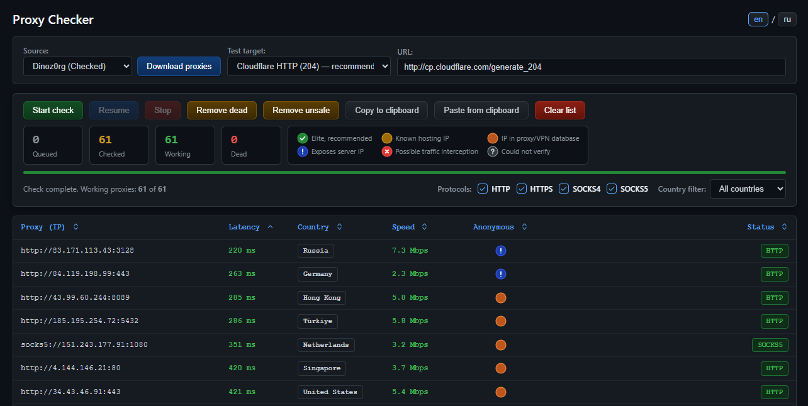

**Languages:** [Русский](README.md) | [English](README-EN.md) 

# Proxy Checker

Check public proxies from open sources. Add a proxy list from the clipboard or download it from one of the available sources. Checks include protocol detection, latency, speed, TLS interception, anonymity, and country lookup. The proxy list and results are saved in the browser's local storage (localStorage).



## Files

| File | Purpose |
|---|---|
| `proxy-checker.php` | Interface: table, buttons, filters, sorting, and browser storage. Plain HTML + JS, with no PHP code |
| `proxy-lib.php` | Shared utilities: `protocol://IPv4:port` address validation, deduplication by `ip:port`, a 100,000-proxy limit, and running endpoints from the CLI |
| `proxy-fetch.php` | Download a list from a source (`?source=…`) or parse pasted text (`?source=paste`) |
| `proxy-check-batch.php` | Check a batch of proxies in parallel using `curl_multi` |
| `proxy-geoip.php` | Country lookup and proxy/VPN and hosting flags via ip-api.com (batches of up to 100 IPs) |

## Installation

- PHP 8.x with the `curl` extension (PHP-FPM or any web server with PHP support).
- Install the `ca-certificates` package on the server. Without root certificates, TLS interception cannot be checked; the status will be “Could not verify”.
- Copy the files into the website directory and open `proxy-checker.php`.
- A batch of 500 proxies takes up to about 40 seconds (usually about 25 seconds). The script sets `set_time_limit(300)`; nginx/PHP-FPM timeouts must allow enough time, and the 100-second Cloudflare timeout described here is sufficient for such a batch.

## Usage

1. **Source → “Download proxies”** or **“Paste from clipboard”**. If a list already exists, choose “Append to current list” (checked proxies keep their results; new ones are queued) or “Replace entire list”.
2. **Test target** is the address that a proxy must open (default: `http://cp.cloudflare.com/generate_204`).
3. **“Start check”** checks the entire list again. **“Stop”** / **“Resume”** pause the check and resume checking only unchecked proxies, including newly added ones.
4. Clean up the list:
   - **Remove dead** — removes only checked, non-working proxies, immediately without confirmation. Working proxies remain regardless of speed or latency; unchecked proxies remain too.
   - **Remove unsafe** — removes proxies with “Possible traffic interception” or “Could not verify” status. While ip-api is still processing, the button asks you to wait.
5. **Copy to clipboard** — copies all working proxies (`protocol://ip:port`, one per line).

Pressing F5 does not reset the list or results: they are saved after each batch.

The **en / ru** switch to the right of the title changes the language of the interface, messages, statuses, and country names without reloading the page or interrupting a check. Russian is the default; the selected language is saved in localStorage (`proxy-checker.lang`).

## How checks work

The browser sends batches of 500 proxies to `proxy-check-batch.php`.

1. **Calibration** (direct requests from the server, 3 seconds each): determines whether the server can validate certificates and what the header judge sees without a proxy, including the server IP.
2. **Protocol detection**: requests the test target using HTTP, HTTPS, SOCKS4, and SOCKS5 in turn, trying the protocol specified in the address first. Each protocol has a 6-second timeout. The first protocol that responds is written into the proxy address.
3. Additional checks run in parallel, without extending the batch:
   - **Speed** — downloads 1 MB from `speed.cloudflare.com`. A proxy is considered working if it downloads the entire file or at least 30 KB before the timeout.
   - **TLS** — a small HTTPS request with certificate validation. A certificate error indicates that the proxy replaces the TLS certificate.
   - **Headers** (HTTP/HTTPS proxies only) — requests the header judge at `http://azenv.net/` and compares its response with calibration: whether the server IP is exposed and whether headers such as Via or X-Forwarded-For are present. SOCKS does not modify HTTP headers.
4. If the TLS request or header judge request does not respond (a transient failure), the proxy is checked again once in the next batch. Counters do not change during this retry.

The countdown in the “Status” column (`HTTP 5s … SOCKS5 1s`, then `SPEED…`) is decorative: the server returns one response for the entire batch.

After checking, working proxies are sent to `proxy-geoip.php` for country lookup and ip-api flags.

## Anonymity statuses

The browser combines the server's response and ip-api data to determine the status. Click a circle in the table for details; click the legend for descriptions of all statuses.

| Color | Status | Condition |
|---|---|---|
| Green ✓ | Elite, recommended | Authentic TLS certificate, clean headers (or SOCKS), and an ip-api response with no flags |
| Yellow | Known hosting IP | ip-api identifies a data center IP |
| Orange | IP in proxy/VPN database | ip-api flags a known proxy/VPN, or the proxy reveals itself through headers such as Via or X-Forwarded-For without your IP |
| Light blue ! | Exposes server IP | The header judge sees the connecting client's IP in the headers (a transparent proxy) |
| Red × | Possible traffic interception | The proxy replaces the TLS certificate |
| Gray ? | Could not verify | TLS or the header judge did not respond even after a retry, or ip-api did not respond |

Priority (first match): interception → exposed IP → proxy/VPN → hosting → could not verify → elite. Until ip-api responds, the status is gray. Sorting by the “Anonymous” column orders statuses as follows: elite → hosting → proxy/VPN → not verified → exposed IP → interception.

Unsafe proxies still count as working (their protocol badge is green); “DEAD” (“МЕРТВЫЙ” in the Russian interface) means non-working only.

## ip-api

- The server requests the canonical English country name and country code (`lang=en`). The browser displays the name in the selected language using the built-in `Intl.DisplayNames`; changing the language does not send extra requests to ip-api. Older saved results are also translated by country code. A modern browser with `Intl.DisplayNames` support is required; otherwise, the saved country name is displayed.
- The free batch endpoint allows 15 requests per minute per server IP, with up to 100 IPs per request. `proxy-geoip.php` reads the `X-Rl` / `X-Ttl` headers and returns `retry_after` when the limit is exhausted or the response is HTTP 429; the browser waits and retries. Do not exceed the limit: ip-api may ban the IP for up to an hour.
- IPs with no response (network failure or rate limit) are retried once, and again after F5.
- No proxy/hosting flag does not mean an IP is clean: ip-api does not list many public proxies on residential IPs, such as compromised routers and IoT devices. For example, `27.69.78.20` (Viettel) has no ip-api flags, but proxycheck.io identifies it as a SOCKS4 proxy.
- Alternatives with proxy detection: proxycheck.io (100 requests per day without a key, 1,000 with a free key; each IP counts as a request) and ipapi.is (1,000 per day with a free key; proxy flags are unavailable without a key). The free ip-api service is for non-commercial use only.

## Browser storage

The `proxy-checker.list` localStorage key stores one line per proxy:

```
address                                  — unchecked
address<TAB>0                            — non-working
address<TAB>1<TAB>ms<TAB>bits/s<TAB>tls<TAB>hdr<TAB>headers<TAB>country code<TAB>country<TAB>geo
```

`tls`: `ok` / `mitm` / `na` (no response) / `noca` (no root certificates on the server). `hdr`: `clean` / `socks` / `proxy` / `ip` / `na` / `nojudge`. `geo`: empty — waiting for ip-api, `?` — no response, `-` — no flags, `p` — proxy/VPN, `h` — hosting. The old address-only format is read as an unchecked list. The browser storage budget described here is about 5 million characters, enough for 100,000 proxy addresses; saved results also take up space.

## API

```
GET  proxy-fetch.php?source=dinoz0rg|stormsia|proxifly|thespeedx|geonode
POST proxy-fetch.php?source=paste          body — proxy list as plain text
     → {success, source, count, proxies: ["socks5://1.2.3.4:1080", ...]}

POST proxy-check-batch.php  {"proxies": [{"index": 0, "proxy": "1.2.3.4:1080"}], "target_url": "...", "timeout": 6}
     → {success, count, results: [{index, proxy, ok, proto, time, speed_bits, tls, hdr, hdr_names}]}

POST proxy-geoip.php  {"ips": ["1.2.3.4"]}
     → {success, results: {ip: {country, country_code, proxy, hosting}}, retry_after}
```
