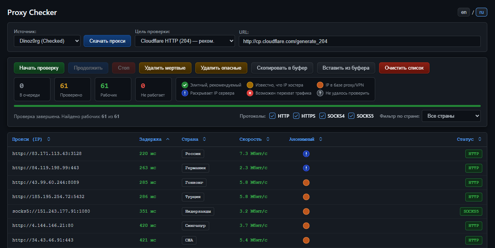

**Languages:** [Русский](README.md) | [English](README-EN.md) 

# Proxy Checker

Проверка публичных прокси из открытых источников. Список прокси можно добавить из буфера обмена или загрузить из списка источников. Проверка прокси включает: проверку протокола, задержку, скорость, подмену TLS и анонимность, определение страны. Список прокси и результаты сохраняются в кеше браузера (localStorage).



## Файлы

| Файл | Назначение |
|---|---|
| `proxy-checker.php` | Интерфейс: таблица, кнопки, фильтры, сортировка, хранение в браузере. Чистый HTML + JS, без PHP-кода |
| `proxy-lib.php` | Общее: маска адреса `протокол://IPv4:порт`, дедуп по `ip:port`, лимит 100 000, запуск эндпоинтов из CLI |
| `proxy-fetch.php` | Скачивание списка из источника (`?source=…`) или разбор вставленного текста (`?source=paste`) |
| `proxy-check-batch.php` | Проверка пачки прокси параллельно через `curl_multi` |
| `proxy-geoip.php` | Страна и пометки «прокси/VPN», «хостинг» через ip-api.com (пакетами до 100 IP) |

## Установка

- PHP 8.x с расширением `curl` (PHP-FPM или любой веб-сервер с PHP).
- Пакет `ca-certificates` на сервере — без корневых сертификатов подмену TLS проверить нельзя (статус будет «Не удалось проверить»).
- Скопировать файлы в каталог сайта, открыть `proxy-checker.php`.
- Пачка из 500 прокси идёт до ~40 с (обычно ~25 с). `set_time_limit(300)` выставляется в скрипте; таймауты nginx/PHP-FPM и Cloudflare (100 с) этого хватает.

## Как пользоваться

1. **Источник → «Скачать прокси»** или **«Вставить из буфера»**. Если список уже есть — «Добавить к текущим» (проверенные сохраняют результаты, новые встают в очередь) или «Заменить весь список».
2. **Цель проверки** — адрес, который прокси должен открыть (по умолчанию `http://cp.cloudflare.com/generate_204`).
3. **«Начать проверку»** — проверяет весь список заново. **«Стоп»** / **«Продолжить»** — пауза и проверка только непроверенных (в том числе только что добавленных).
4. Чистка списка:
   - **Удалить мертвые** — только проверенные нерабочие, сразу без подтверждения. Рабочие с любой скоростью и задержкой, а также ещё не проверенные остаются.
   - **Удалить опасные** — статусы «Возможен перехват трафика» и «Не удалось проверить». Пока ip-api не ответил, кнопка просит подождать.
5. **Скопировать в буфер** — все рабочие (`протокол://ip:порт`, по одному на строку).

F5 ничего не сбрасывает: список и результаты сохраняются после каждой пачки.

Переключатель **en / ru** справа от заголовка меняет язык интерфейса, сообщений, статусов и названий стран без перезагрузки страницы и без остановки проверки. По умолчанию — русский; выбранный язык сохраняется в localStorage (`proxy-checker.lang`).

## Как идёт проверка

Браузер отправляет пачки по 500 прокси в `proxy-check-batch.php`.

1. **Калибровка** (прямые запросы с сервера, по 3 с): умеет ли сервер проверять сертификаты и что видит судья заголовков без прокси (в том числе IP сервера).
2. **Протокол**: запрос к цели проверки по очереди через HTTP, HTTPS, SOCKS4, SOCKS5 (указанный в адресе — первым), таймаут 6 с на протокол. Первый ответивший протокол записывается в адрес.
3. Параллельно, не удлиняя пачку:
   - **Скорость** — скачивание 1 МБ с `speed.cloudflare.com`. Рабочий = скачал всё или до таймаута успел ≥ 30 КБ.
   - **TLS** — маленький HTTPS-запрос с проверкой сертификата. Ошибка сертификата = прокси подменяет TLS.
   - **Заголовки** (только HTTP/HTTPS-прокси) — запрос к судье `http://azenv.net/`, сравнение с калибровкой: есть ли IP сервера, есть ли Via, X-Forwarded-For и т. п. SOCKS заголовки не меняет.
4. Если запрос TLS или к судье не ответил (разовый сбой), прокси один раз перепроверяется в следующей пачке; счётчики при этом не меняются.

Отсчёт в колонке «Статус» (`HTTP 5с … SOCKS5 1с`, затем `SPEED…`) — декоративный: сервер отвечает один раз на всю пачку.

После проверки рабочие уходят в `proxy-geoip.php` (страна и пометки ip-api).

## Статусы анонимности

Статус собирает браузер из ответа сервера и ip-api. Клик по кругу в таблице — подробности, клик по легенде — описание всех статусов.

| Цвет | Статус | Когда |
|---|---|---|
| зелёный ✓ | Элитный, рекомендуемый | TLS подлинный, заголовки чистые (или SOCKS), ip-api ответил и пометок нет |
| жёлтый | Известно, что IP хостера | ip-api: IP дата-центра |
| оранжевый | IP в базе proxy/VPN | ip-api: известный прокси/VPN, или прокси выдаёт себя заголовками (Via, X-Forwarded-For без вашего IP…) |
| голубой ! | Раскрывает IP сервера | в заголовках у судьи виден IP подключившегося (прозрачный прокси) |
| красный × | Возможен перехват трафика | подменяет TLS-сертификат |
| серый ? | Не удалось проверить | TLS или судья не ответили и после повтора, либо ip-api не ответил |

Приоритет (первое совпадение): перехват → раскрывает IP → прокси/VPN → хостинг → не удалось проверить → элитный. До ответа ip-api статус серый. Сортировка по колонке «Анонимный»: элитный → хостинг → прокси/VPN → не проверено → раскрывает IP → перехват.

Опасные прокси считаются рабочими (статус протокола зелёный); «МЕРТВЫЙ» (в английской версии — «DEAD») — только нерабочие.

## ip-api

- Сервер запрашивает каноническое английское имя и код страны (`lang=en`). Браузер показывает название на выбранном языке через встроенный `Intl.DisplayNames`; переключение языка не создаёт дополнительных запросов к ip-api. Старые сохранённые результаты также переводятся по коду страны. Нужен современный браузер с поддержкой `Intl.DisplayNames`; без неё показывается сохранённое имя страны.
- Бесплатный batch-эндпоинт: 15 запросов в минуту с IP сервера, до 100 IP в запросе. `proxy-geoip.php` читает заголовки `X-Rl` / `X-Ttl` и при исчерпании лимита (или ответе 429) возвращает `retry_after`; браузер ждёт и повторяет. Превышать лимит нельзя — ip-api банит IP до часа.
- IP без ответа (сеть, лимит) повторяются один раз, после F5 — ещё раз.
- Нет пометки «прокси/хостинг» ≠ «IP чистый»: в базе ip-api нет многих публичных прокси на домашних IP (взломанные роутеры, IoT). Пример: `27.69.78.20` (Viettel) у ip-api без пометок, а proxycheck.io знает его как SOCKS4-прокси.
- Альтернативы с определением прокси: proxycheck.io (100 запросов в сутки без ключа, 1000 — с бесплатным ключом, каждый IP = запрос), ipapi.is (1000 в сутки с бесплатным ключом; без ключа пометок нет). Условия ip-api — только некоммерческое использование.

## Хранение в браузере

Ключ `proxy-checker.list` в localStorage, строка на прокси:

```
адрес                                    — не проверен
адрес<TAB>0                              — не работает
адрес<TAB>1<TAB>мс<TAB>бит/с<TAB>tls<TAB>hdr<TAB>заголовки<TAB>код страны<TAB>страна<TAB>geo
```

`tls`: `ok` / `mitm` / `na` (не ответил) / `noca` (на сервере нет сертификатов). `hdr`: `clean` / `socks` / `proxy` / `ip` / `na` / `nojudge`. `geo`: пусто — ждём ip-api, `?` — не ответил, `-` — без пометок, `p` — прокси/VPN, `h` — хостинг. Старый формат (только адреса) читается как непроверенный список. Лимит браузера ~5 млн символов — 100 000 прокси помещаются.

## API

```
GET  proxy-fetch.php?source=dinoz0rg|stormsia|proxifly|thespeedx|geonode
POST proxy-fetch.php?source=paste          тело — текст списка
     → {success, source, count, proxies: ["socks5://1.2.3.4:1080", ...]}

POST proxy-check-batch.php  {"proxies": [{"index": 0, "proxy": "1.2.3.4:1080"}], "target_url": "...", "timeout": 6}
     → {success, count, results: [{index, proxy, ok, proto, time, speed_bits, tls, hdr, hdr_names}]}

POST proxy-geoip.php  {"ips": ["1.2.3.4"]}
     → {success, results: {ip: {country, country_code, proxy, hosting}}, retry_after}
```

